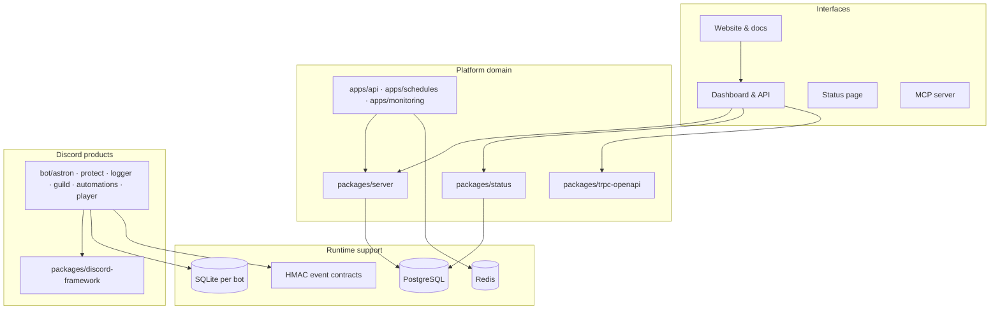

<div align="center">

<h1>Astron Collection</h1>

<p><strong>The open-source platform for Discord communities.</strong></p>

<p>Six focused bots. A self-hostable control plane. A status page, documentation and the shared foundation that holds them together.</p>

<p>
  <a href="https://astron-collection.com">Website</a> ·
  <a href="https://docs.astron-collection.com">Documentation</a> ·
  <a href="https://status.astron-collection.com">Status</a> ·
  <a href="https://discord.gg/GUkDugVh34">Discord</a> ·
  <a href="https://github.com/skygenesisenterprise/astron-collection/issues">Issues</a>
</p>

<p>
  <a href="LICENSE"></a>
  <a href="https://nodejs.org"></a>
  <a href="https://pnpm.io"></a>
  <a href="https://www.typescriptlang.org"></a>
  <a href="https://discord.js.org"></a>
  <a href="https://nextjs.org"></a>
</p>

</div>

---

Astron Collection is an open-source, self-hostable platform for running a complete
Discord community stack. It is built for server owners, moderators and developers
who want focused tools, clear ownership boundaries and their community data on
infrastructure they control.

Run one bot or all six. Self-host the control plane with Docker Compose, or use
[Astron Collection Cloud](https://app.astron-collection.com) for a managed
experience. Every component is independently deployable, and no bot depends on the
platform being online.

## ✨ Highlights

- **Six focused bots, not one monolith.** Astron handles general utilities,
  Protect moderates, Logger audits, Guild engages, Automations orchestrates and
  Player plays music. Each has its own Discord application, token, command
  catalogue, database and image.
- **One technical foundation.** Commands, events, permissions, configuration,
  SQLite storage, migrations, logging, health checks and graceful shutdown are
  shared through `packages/discord-framework` so each bot stays small and
  consistent.
- **Your infrastructure, your data.** Bots store their own SQLite files. The
  control plane uses your PostgreSQL and Redis. Nothing is sent to a third party
  unless you configure it.
- **Contracts, not shared databases.** Bots integrate through versioned,
  HMAC-signed events with a transactional outbox and consumer deduplication.
- **Operable by default.** Health endpoints, Prometheus-style metrics, structured
  JSON logs, checksummed migrations, non-root containers and graceful shutdown
  are part of the foundation.
- **Open source and extensible.** Apache-2.0, a single pnpm workspace, clear
  package boundaries and a static isolation check for the Discord layer.

## 📦 What's inside

| Product | What it does | Where |
| --- | --- | --- |
| **Discord bots** | Six independent Discord applications covering community, moderation, audit, engagement, automations and voice | [`bot/`](bot) |
| **Control plane** | Dashboard, API, auth, WebSockets, workers and scheduled jobs | [`apps/astron`](apps/astron), [`apps/api`](apps/api), [`apps/schedules`](apps/schedules) |
| **Status product** | Public status page, incident/maintenance state and notification outbox | [`apps/status`](apps/status), [`packages/status`](packages/status) |
| **Web properties** | Marketing website and documentation site with their own workspace | [`web/`](web) |
| **Shared foundations** | Bot framework, platform domain, OpenAPI bridge and MCP server | [`packages/`](packages) |
| **Design system** | React components, primitives, tokens and component documentation | [`packages/node`](packages/node) |

## 🧱 Project support structure

Astron Collection is organized as **support layers**. Each layer has one job and
depends only on the layer beneath it. This is what keeps six bots, a control
plane and several web properties releasable without turning the repository into a
single coupled application.



| Layer | Location | Owns | Depends on |
| --- | --- | --- | --- |
| **Interfaces** | `apps/astron`, `apps/status`, `web/`, `packages/mcp` | Screens, HTTP surfaces, docs, AI tools | Platform domain, UI foundation |
| **Platform services** | `apps/api`, `apps/schedules`, `apps/monitoring` | Background jobs, schedules, metrics collection | Domain packages, PostgreSQL, Redis |
| **Platform domain** | `packages/server`, `packages/status`, `packages/trpc-openapi` | Persistence, auth support, status state, API contracts | Runtime libraries only |
| **Discord products** | `bot/*` | Commands, events, bot services, bot repositories | `packages/discord-framework`, own SQLite |
| **Bot foundation** | `packages/discord-framework` | Lifecycle, routing, permissions, storage, contracts, observability | `discord.js` / voice as optional peers |
| **UI foundation** | `packages/node` | React components, tokens, component documentation | React ecosystem |
| **Support tooling** | `scripts/`, `Makefile`, `.github/` | Install, checks, isolation validation, CI, publishing | Repository tools |

### Repository map

```text
astron-collection/
├── apps/                         # Platform products
│   ├── astron/                   # @astron-collection/app — dashboard, API, runtime, desktop shell
│   ├── api/                      # @astron-collection/api — Inngest background work
│   ├── schedules/                # @astron-collection/schedules — BullMQ scheduled jobs
│   ├── status/                   # @astron-collection/status-app — public status page
│   └── monitoring/               # Go metrics service (outside the pnpm workspace)
├── bot/                          # Six independent Discord applications
│   ├── astron/                   # @astron-collection/astron
│   ├── protect/                  # @astron-collection/protect
│   ├── logger/                   # @astron-collection/logger
│   ├── guild/                    # @astron-collection/guild
│   ├── automations/              # @astron-collection/automations
│   └── player/                   # @astron-collection/player
├── packages/
│   ├── discord-framework/        # Shared bot foundation
│   ├── server/                   # Platform domain, persistence, auth utilities
│   ├── status/                   # Status engine, APIs, notification outbox
│   ├── trpc-openapi/             # tRPC ↔ OpenAPI bridge
│   ├── mcp/                      # Model Context Protocol server
│   └── node/                     # Nested React design-system toolchain
├── web/                          # Separate workspace: website, docs, Dockerfiles, Makefile
├── scripts/                      # Install, worktree, docs and isolation tooling
├── docker/                       # Deployment-tooling install helper
├── .github/                      # CI workflows, templates, support and security files
├── Dockerfile                    # Platform image: dev / status / platform targets
├── entrypoint.sh                 # Runtime role selection for the platform image
├── docker-compose.yml            # Platform stack: postgres, redis, client, api
├── bot/<name>/docker-compose.yml # One standalone Compose project per bot
├── Makefile                      # Thin wrapper over pnpm, Docker and scripts
├── .env.example                  # Platform environment template
└── pnpm-workspace.yaml           # Workspace and dependency catalog
```

### Dependency rules

1. A bot depends only on the framework and its runtime. It must never import
   `apps/*`, `packages/server`, `packages/status` or another bot.
2. The framework contains no business logic. It does not know what a moderation
   case, level, workflow or playlist is.
3. Domain packages do not import applications. Applications compose them.
4. Applications do not import each other. Shared behaviour belongs in a package.
5. Web workspaces are independent and can be built without the platform.
6. Bots never share a database. Cross-bot integration uses event contracts.
7. Secrets stay at the edge; loggers redact token and secret-shaped values.

### Data ownership

| Store | Owner | Contents |
| --- | --- | --- |
| PostgreSQL | Platform (`apps/astron` / `packages/server`) | Users, organizations, projects, servers, deployments, audit and platform settings |
| Redis | Platform (`apps/api`, `apps/schedules`, `apps/astron`) | Cache, BullMQ queues, coordination |
| SQLite `<bot>.sqlite3` | Each bot | That bot's cases, logs, members, workflows, playlists, settings and outbox |
| Status persistence | `packages/status` / `apps/status` | Status components, incidents, maintenance windows and notification outbox |

No database is shared between two bots. Bot repositories always filter by
`guild_id`, and a guild cannot read another guild's rows through a command.

## 🤖 Discord bots

| Bot | Package | Domain | Image |
| --- | --- | --- | --- |
| **Astron** | `@astron-collection/astron` | General utilities: help, status, server/user/role/channel info, docs, support, invite, language, configuration | `ghcr.io/skygenesisenterprise/astron` |
| **Protect** | `@astron-collection/protect` | Moderation, cases, quarantine, phishing/raid protection, AutoMod, security findings | `ghcr.io/skygenesisenterprise/astron-protect` |
| **Logger** | `@astron-collection/logger` | Audit log, message/member/channel/role events, log search, signed event ingest | `ghcr.io/skygenesisenterprise/astron-logger` |
| **Guild** | `@astron-collection/guild` | Welcome/farewell, autorole, XP and levels, reaction roles, polls, suggestions, birthdays, reminders | `ghcr.io/skygenesisenterprise/astron-guild` |
| **Automations** | `@astron-collection/automations` | Workflows with message, member-join, cron and contract-event triggers; ordered actions; run history | `ghcr.io/skygenesisenterprise/astron-automations` |
| **Player** | `@astron-collection/player` | Voice queues, playback controls, playlists, history, yt-dlp/ffmpeg playback | `ghcr.io/skygenesisenterprise/astron-player` |

Each bot is a separate Discord application with its own token, application ID,
command deployment state, minimal intents, SQLite database, health port, named
volume and container image. Bots can be scaled, restarted, updated or removed
independently.

### Per-bot layout

```text
bot/<name>/
├── index.js               # createServices + startBot; no manually created client
├── deploy-commands.js     # framework deployment runner
├── components.js          # optional buttons/selects/modals
├── config/
│   ├── bot.js             # identity, intents, defaults, validators
│   └── env.js             # environment schema and validation
├── commands/              # only this bot's commands
├── events/                # gateway listeners or grouped `events` arrays
├── services/              # business orchestration for this domain
├── repositories/          # SQL scoped by guild_id
├── migrations/            # numbered, checksummed SQL migrations
├── lib/                   # domain views and helpers
├── test/ or tests/        # node:test suites
├── Dockerfile
├── entrypoint.sh
├── docker-compose.yml
├── .env.example
└── README.md
```

### Shared bot foundation

`packages/discord-framework` provides the technical support layer for every bot.
It has no runtime dependency: `discord.js` and `@discordjs/voice` are optional
peers, and external effects are injectable.

| Module | Support provided |
| --- | --- |
| `src/lifecycle.js` | Client creation, bootstrap, login retries, `clientReady`, signals, shutdown, health |
| `src/commands/` | Command contract, per-bot registry, duplicate and foreign-bot rejection, loader |
| `src/interactions/` | Slash/context routing, components, versioned custom IDs, autocomplete, cooldowns |
| `src/permissions.js` | Layered, fail-closed user/bot/business authorization |
| `src/errors.js` | Expected vs unexpected errors with safe user messages |
| `src/logger.js` | Structured JSON logs with token/secret redaction |
| `src/config/env.js` | Schema-based environment parsing and required-variable checks |
| `src/storage/` | SQLite wrapper, migrations, checksum drift detection |
| `src/settings/` | Per-guild settings defaults and validators |
| `src/localization/` | Shared French/English catalogs and translator |
| `src/observability/` | Metrics registry and HTTP health/metrics/ingest server |
| `src/contracts/` | Versioned events, event bus, transactional outbox, HMAC webhook sink/verifier |
| `src/ui/` | Formatting helpers plus discord.js embeds/builders |
| `src/deploy/` | Idempotent command deployment with application guard and dry run |
| `src/voice/` | Optional official voice presence/session support |
| `src/bootstrap.js` | One-call service and runtime composition |

The framework suite runs without installing anything:

```bash
node --disable-warning=ExperimentalWarning --test packages/discord-framework/test/*.test.js
```

### Bot isolation

Isolation is checked, not assumed:

- each bot has its own command registry, and the framework rejects commands
  stamped with another bot's name;
- command and event directories are loaded per bot;
- `interactionCreate` belongs to the framework and cannot be overridden;
- `scripts/check-bots.mjs` verifies the six directories, required files, package
  names, framework imports, catalogues, test directories and forbidden cross-bot
  imports.

```bash
node scripts/check-bots.mjs
```

### Event contracts

Bots integrate through versioned envelopes, never through shared tables. A
producer writes an event to its SQLite outbox in the same transaction as its
domain change. A delivery loop posts the envelope to the consumer's signed HTTP
endpoint. Delivery is at-least-once; consumers deduplicate by event id.

| Event | Producer | Primary consumer |
| --- | --- | --- |
| `moderation.case.created` | Protect | Logger |
| `moderation.case.updated` | Protect | Logger |
| `security.alert` | Protect | Logger |
| `member.joined` | Guild | Logger, Automations |
| `member.left` | Guild | Logger, Automations |
| `level.up` | Guild | Logger |
| `suggestion.created` | Guild | Logger |
| `workflow.executed` | Automations | Logger |
| `track.started` | Player | Logger |

Envelopes carry an id, type, version, source, timestamp and guild-scoped payload.
Requests are signed with HMAC-SHA256 over the timestamp and raw body. Leaving
`ASTRON_EVENT_URL` empty keeps events in the producer's outbox and sends nothing.

## 🖥️ Platform

| Path | Package | Role |
| --- | --- | --- |
| `apps/astron` | `@astron-collection/app` | Next.js dashboard, Node API server (tRPC/OpenAPI, better-auth, WebSockets, workers), migrations, optional Electron desktop shell |
| `apps/api` | `@astron-collection/api` | Inngest background work and HTTP triggers, port 4000 |
| `apps/schedules` | `@astron-collection/schedules` | BullMQ scheduled and recurring jobs, port 4001 |
| `apps/status` | `@astron-collection/status-app` | Standalone public status page, port 4100 |
| `apps/monitoring` | Go module | Host/container metrics, thresholds and callback notifications, port 3001 |

`apps/astron` is the control-plane composition root. It consumes
`@astron-collection/server`, `@astron-collection/status` and
`@astron-collection/trpc-openapi`, and it is the only application that applies
platform migrations.

| Package | Role |
| --- | --- |
| `@astron-collection/server` | Domain logic, Drizzle schema and migrations, auth support, integrations |
| `@astron-collection/status` | Status domain, state computation, persistence, APIs, notification outbox |
| `@astron-collection/trpc-openapi` | tRPC ↔ OpenAPI adapter |
| `@astron-collection/mcp` | MCP server over stdio, HTTP or SSE |

The root Compose stack runs exactly four service groups: `postgres`, `redis`,
`client` and `api`. The client and API share one image digest; only the API holds
database and Redis credentials and applies migrations.

### Web and design system

`web/` is a separate pnpm workspace with its own Makefile, Compose file and
Dockerfiles:

| Path | Package | Role | Dev port |
| --- | --- | --- | --- |
| `web/apps/website` | `@astron-collection/website` | Marketing site | 3000 |
| `web/apps/docs` | `@astron-collection/docs` | Documentation and generated API/CLI references | 3001 |

`packages/node` is a nested React design-system workspace.
`@astron-collection/react` provides components, primitives, tokens and themes;
`@astron-collection/react-docs-astro` builds the component documentation. Only
those two package paths are included in the root workspace, so their Vite+,
Astro and Playwright toolchain stays independent.

## 🧰 Technology

| Area | Stack |
| --- | --- |
| Discord bots | Node.js 22+, discord.js 14, plain ESM with JSDoc, `node:sqlite` |
| Bot foundation | Dependency-free ESM modules, optional `discord.js` / `@discordjs/voice` peers |
| Platform | TypeScript 7, Next.js 16, tRPC, Drizzle ORM, PostgreSQL, Redis, better-auth, BullMQ, Inngest |
| Web | Next.js 16, Fumadocs, Tailwind CSS |
| Design system | React 19, Vite+, Astro, Playwright |
| Runtime | Docker, Docker Compose, GHCR, GitHub Actions |
| Quality | Biome, `node:test`, Vitest, CodeQL, dependency review |

## ⚡ Quick start

### Prerequisites

- **Node.js 24.4+** (`.nvmrc` pins `24.4.0`) and **pnpm 12.16.1**
- A **Discord application** per bot you want to run
- **Docker Engine** with the Compose plugin for containers
- **PostgreSQL** and **Redis** only for the full control plane (Compose provides both)
- **Go 1.21+** only for `apps/monitoring`
- **ffmpeg** and **yt-dlp** for real Player playback

```bash
git clone https://github.com/skygenesisenterprise/astron-collection.git
cd astron-collection
pnpm install --frozen-lockfile
```

### Run the platform

```bash
cp .env.example .env
```

Set `POSTGRES_PASSWORD`, `REDIS_PASSWORD` and `BETTER_AUTH_SECRET` in `.env`.
Generate each secret with `openssl rand -hex 32`. Then:

```bash
docker compose up -d --build
docker compose logs -f api
```

| Service | URL |
| --- | --- |
| Dashboard | [http://localhost:3000](http://localhost:3000) |
| API | [http://localhost:4000](http://localhost:4000) |
| Status page (standalone) | [http://localhost:4100](http://localhost:4100) |

PostgreSQL and Redis stay internal. Keep `.env` private, and do not expose the
dashboard publicly before authentication and HTTPS are configured.

### Run one bot locally

Each bot reads `bot/<name>/.env` first, then falls back to the repository root
`.env`.

```bash
cp bot/logger/.env.example bot/logger/.env
# set the Discord token and application ID for this bot

pnpm --filter=@astron-collection/logger deploy:commands
pnpm --filter=@astron-collection/logger dev
```

Swap `logger` for `astron`, `protect`, `guild`, `automations` or `player`. Invite
the application with the `bot` and `applications.commands` scopes.

### Run the bots

Each bot is its own Compose project: one image, one process, one SQLite volume
and one published health port (3010–3015). They can be started independently,
in any order, without the control plane.

```bash
for bot in astron automations guild logger player protect; do
  cp bot/$bot/.env.example bot/$bot/.env   # then fill in that bot's credentials
done

docker compose -f bot/astron/docker-compose.yml up -d --build
docker compose -f bot/astron/docker-compose.yml ps
# or: make docker-up astron   (swap astron for any other bot name)
```

`docker compose -f bot/<name>/docker-compose.yml down` preserves that bot's data
volume. Cross-bot event delivery uses each bot's published port through
`host.docker.internal` (already mapped in every Compose file); no shared network
or Redis is required.

## 🛠️ Development

| Command | What it runs |
| --- | --- |
| `pnpm dev` | Dashboard/API server in development |
| `pnpm build` | Recursive workspace build |
| `pnpm build:app` | Main application build |
| `pnpm test` | Application test suite |
| `pnpm test:bots` | Shared Discord framework test suite |
| `pnpm check:bots` | Six-bot isolation and structure check |
| `pnpm typecheck` | Recursive TypeScript type-check |
| `pnpm lint` | Recursive lint/format checks |
| `pnpm setup` | Platform database setup and migrations |
| `pnpm generate:openapi` | Regenerate the OpenAPI specification |
| `pnpm docs:check` | Validate documentation specs, regions and links |
| `pnpm web:dev` / `pnpm docs:dev` | Marketing site / documentation site |
| `pnpm changeset` | Add a changeset for a user-facing change |

### Platform services

```bash
pnpm --filter=@astron-collection/api run dev
pnpm --filter=@astron-collection/api run dev:inngest
pnpm --filter=@astron-collection/schedules run dev
pnpm --filter=@astron-collection/status-app run dev
```

### Web properties

```bash
make -C web dev web
make -C web dev docs
make -C web build
```

### Checks

```bash
pnpm lint
pnpm typecheck
pnpm test
node scripts/check-bots.mjs

for bot in astron automations guild logger player protect; do
  node --disable-warning=ExperimentalWarning --test bot/$bot/test*/*.test.js || exit 1
done
```

`astron`, `protect` and `logger` use `test/`; `guild`, `automations` and `player`
use `tests/`. The isolation check is cheap enough to run on every change.

## 🚀 Deployment

### Images

| Product | Image |
| --- | --- |
| Platform (self-hosted / cloud) | `ghcr.io/skygenesisenterprise/astron-manager` |
| Astron bot | `ghcr.io/skygenesisenterprise/astron` |
| Protect bot | `ghcr.io/skygenesisenterprise/astron-protect` |
| Logger bot | `ghcr.io/skygenesisenterprise/astron-logger` |
| Guild bot | `ghcr.io/skygenesisenterprise/astron-guild` |
| Automations bot | `ghcr.io/skygenesisenterprise/astron-automations` |
| Player bot | `ghcr.io/skygenesisenterprise/astron-player` |
| Status page | Built from the root Dockerfile `status` target |
| Website / docs | Separate images under `web/` |

The root Dockerfile supports `dev`, `status` and `platform` targets. `platform`
is the default. The platform container selects its role at runtime:
`ASTRON_COLLECTION_ROLE=client`, `api` or `migrate`. The self-hosted and cloud
contexts share the same `astron-manager` image and differ only by build args and
runtime configuration, not by service topology.

### Configuration

| Scope | Template | Required values |
| --- | --- | --- |
| Platform | `.env.example` | `POSTGRES_PASSWORD`, `REDIS_PASSWORD`, `BETTER_AUTH_SECRET`; optional OAuth providers |
| Each bot | `bot/<name>/.env.example` | That bot's Discord token and application ID; optional guild ID and event settings |

Typical bot variables:

| Variable | Purpose |
| --- | --- |
| `DISCORD_TOKEN` | Bot token for this application |
| Discord application/client ID | Command deployment identity; must be unique per bot |
| `DISCORD_GUILD_ID` | Optional guild-scoped deployment during development |
| `ASTRON_HEALTH_PORT` | Health and metrics HTTP port |
| `ASTRON_LOG_LEVEL` | `debug`, `info`, `warn`, `error` |
| `ASTRON_DATABASE_PATH` | SQLite file path |
| `ASTRON_EVENT_URL` / `ASTRON_EVENT_SECRET` | Outbound contract delivery and signature |
| `ASTRON_INGEST_PATH` | Logger/Automations signed ingest path |
| `ASTRON_DEPLOY_COMMANDS` | Deploy once at container start, then remove |

Each bot must use its own Discord application ID. A global deployment replaces
that application's entire global command catalogue. Never share one application
ID between two bots unless you intentionally coordinate their commands in guild
scope.

Secrets belong only in `.env` files or the deployment secret store. They are
never committed, and structured logs redact token/secret-shaped values.

## 📈 Operations

- **Health and metrics** — bots serve `/healthz`, `/livez` and `/metrics` on
  `ASTRON_HEALTH_PORT`; platform containers use role-aware health checks.
- **Structured logs** — bots emit JSON lines with `ts`, `level`, `bot`, `msg` and
  context. Secrets and token-shaped strings are redacted.
- **Graceful shutdown** — SIGTERM/SIGINT remove listeners, stop timers and voice
  sessions, close SQLite and destroy the Discord client once.
- **Migrations** — bot migrations run at startup with checksums; platform
  migrations run through the API role or `make migrate`.
- **Backups** — `make backup` dumps PostgreSQL to `backups/`; restore with
  `make restore FILE=...`. Back up bot volumes (SQLite files) like any database.
- **Updates** — pull the revision and rebuild the affected products. Bots and the
  platform update independently; published version tags are immutable.
- **Outbox retries** — undelivered contract events remain in the producer's
  outbox and are retried. Consumers deduplicate, so replay is safe.

### Command deployment

```bash
pnpm --filter=@astron-collection/<bot> deploy:commands
```

Deployment is idempotent: the catalogue is hashed, unchanged catalogues are not
sent again, and a state file guards against using the wrong application.

## 📚 Documentation and support

| Resource | Link |
| --- | --- |
| Product documentation | [docs.astron-collection.com](https://docs.astron-collection.com) |
| Website | [astron-collection.com](https://astron-collection.com) |
| Status page | [status.astron-collection.com](https://status.astron-collection.com) |
| Bot architecture | [`bot/README.md`](bot/README.md) |
| Bot framework | [`packages/discord-framework/README.md`](packages/discord-framework/README.md) |
| MCP server | [`packages/mcp/README.md`](packages/mcp/README.md) |
| Monitoring | [`apps/monitoring/README.md`](apps/monitoring/README.md) |
| Community | [Discord](https://discord.gg/GUkDugVh34) |
| Bugs and requests | [GitHub Issues](https://github.com/skygenesisenterprise/astron-collection/issues) |
| Commercial support | [Sky Genesis Enterprise](https://skygenesisenterprise.com) |

### Common checks

| Symptom | First place to look |
| --- | --- |
| A bot exits as unconfigured | Its `bot/<name>/.env`: token and application ID |
| Slash commands are missing | Run `deploy:commands`; confirm the application ID and scope |
| Contract events never arrive | `ASTRON_EVENT_URL`, matching secret, ingest path, outbox logs |
| Player joins but produces no sound | `ffmpeg`, `yt-dlp`, voice permissions, connection logs |
| The platform refuses to start | Missing `POSTGRES_PASSWORD`, `REDIS_PASSWORD` or a weak `BETTER_AUTH_SECRET` |
| Two bots overwrite each other's commands | They share an application ID; give each bot its own application |
| Cross-bot import or structure error | `node scripts/check-bots.mjs` output |

## 🤝 Contributing

Contributions are welcome. Read the [Code of Conduct](CODE_OF_CONDUCT.md) and the
[contribution guide](.github/CONTRIBUTING.md), keep pull request titles in
Conventional Commits format, and add a changeset for user-facing changes.

```bash
pnpm lint
pnpm typecheck
pnpm test
node scripts/check-bots.mjs
```

Please never paste tokens, credentials or customer data into an issue or pull
request.

## 🔒 Security

Do not report vulnerabilities in public issues. Follow [`SECURITY.md`](SECURITY.md)
or email [security@skygenesisenterprise.com](mailto:security@skygenesisenterprise.com)
with reproduction steps.

## 📄 License

The repository is licensed under the [Apache License 2.0](LICENSE). Some packages
or included components may carry their own license; check the relevant package's
license before redistributing it.

---

<div align="center">

Maintained by [Sky Genesis Enterprise](https://skygenesisenterprise.com).

</div>
